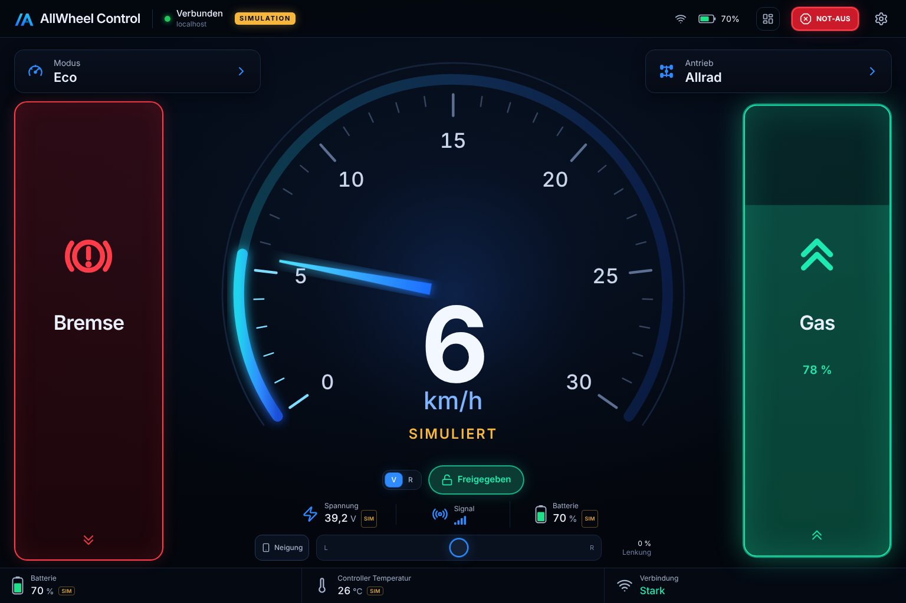
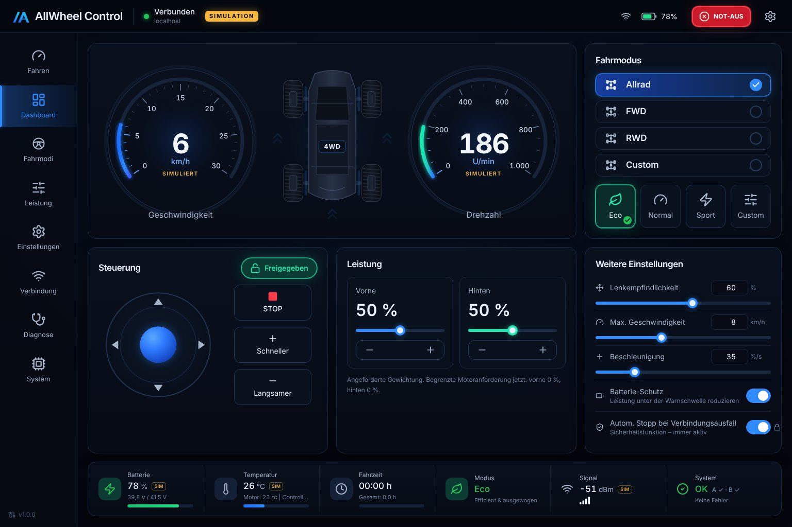
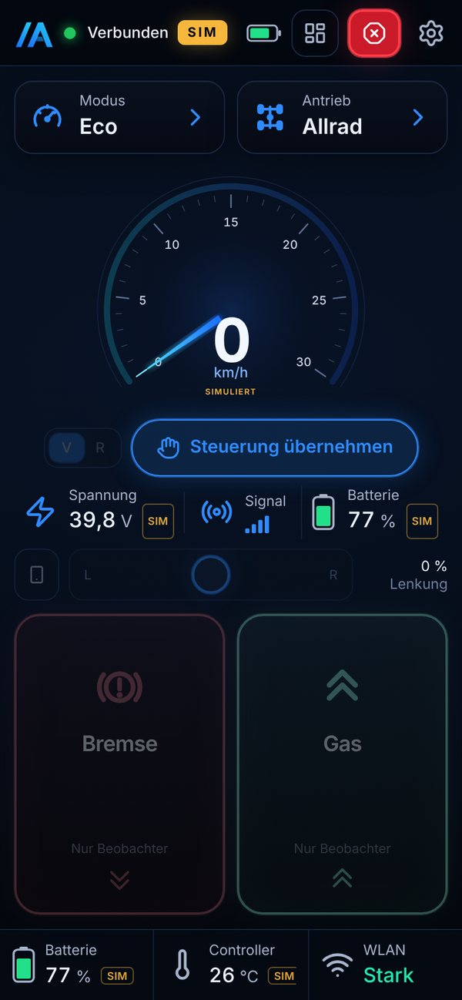
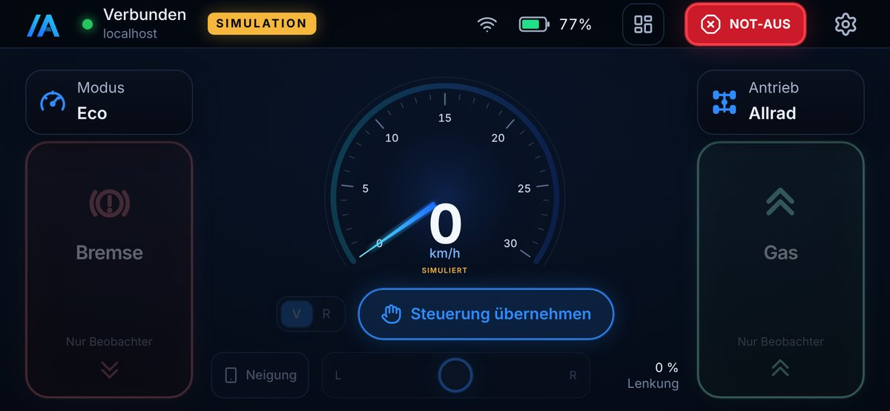

# AllWheel Control

Fahrzeugsteuerung als lokale Web-App für ein elektrisches Allradfahrzeug aus zwei Hoverboards:
**Raspberry Pi 3B** als Steuerrechner, **zwei Hoverboard-Motorcontroller** (vier Nabenmotoren),
Bedienung über **Smartphone oder Tablet im Browser** – ohne App-Installation, ohne Internet.

> **Startet immer im SIMULATIONSMODUS.** Es werden keine realen Motorbefehle gesendet, bis die
> Hardware identifiziert, konfiguriert und über eine Checkliste plus Umgebungsvariable ausdrücklich
> freigegeben ist. Die Software ersetzt **keinen** Hardware-Not-Aus – siehe [docs/safety.md](docs/safety.md).

| Fahransicht (Tablet) | Übersicht (Tablet) |
|---|---|
|  |  |

| Smartphone hoch | Smartphone quer |
|---|---|
|  |  |

## Funktionen

* **Fahransicht** nach Referenzbild: großer animierter Tacho, Bremse links, Gas rechts (Totmann,
  proportional), Modus- und Antriebskarte, Spannung/Signal/Batterie, Statusleiste.
* **Übersicht** nach Referenzbild: Tacho, Drehzahl, Fahrzeug-Draufsicht mit Radanforderungen,
  Antriebs- und Fahrmodus, Joystick, STOP, Schneller/Langsamer, Leistung vorne/hinten, Einstellungen.
* **Fahrprofile** Eco, Normal, Sport, Custom (Gas, Rampe, Verzögerung, Lenkung, Totzone, Geschwindigkeit,
  Achs- und Seitenbegrenzung) – alle im Backend validiert und auf Sicherheitsgrenzen begrenzt.
* **Antriebsmodi** Allrad, FWD, RWD, Custom mit dokumentierter Leistungsgewichtung; nicht unterstützte
  Modi werden als nicht verfügbar angezeigt.
* **Neigungssteuerung** (optional) mit Kalibrierung, Empfindlichkeit, Totzone, Glättung, iOS-Berechtigung,
  automatischem Rückfall auf den Lenkregler.
* **Sicherheit**: Motorfreigabe nur bewusst (halten), Not-Aus, Watchdog (Befehle, Verbindung, Controller,
  Messdaten, Regelschleife), Neutralverriegelung, Sequenz-/Altersprüfung, eindeutiger Steuerungsbesitz,
  Fehlercodes mit Erklärung, Ereignisprotokoll.
* **Messwerte mit Zustand** (gemessen / simuliert / veraltet / nicht verfügbar) – nichts wird erfunden.
* **Simulation** mit Fahrzeugphysik, Akku- und Temperaturmodell sowie Fehlerinjektion.
* **Hardwareadapter** für *hoverboard-firmware-hack-FOC* (USART), Protokoll gegen die Originalquellen geprüft.
* **Betrieb**: versionierte Einstellungen (SQLite), PIN/Admin-Passwort, systemd mit Watchdog, Access Point, TLS optional, Docker optional.

## Schnellstart (Entwicklungsrechner, Simulation)

```bash
cd backend && python3 -m venv .venv && .venv/bin/pip install -r requirements-dev.txt
cd ../frontend && npm ci && npm run build
cd ../backend && AWC_DRIVER_PIN=1234 AWC_ADMIN_PASSWORD=admin-entwicklung .venv/bin/python -m app
```

Browser: <http://localhost:8080> → PIN `1234` → **Steuerung übernehmen** → **Freigeben** halten → Gas.
Tastatur: W/↑ Gas, S/↓/Leertaste Bremse, A/D bzw. ←/→ Lenkung.

Raspberry Pi: siehe **[docs/installation.md](docs/installation.md)**.

## Tests

```bash
cd backend && .venv/bin/python -m pytest      # Unit- und Integrationstests (ohne Hardware)
cd frontend && npm test                        # Logiktests (Totmann, Neigung)
cd frontend && npm run e2e                     # Browser-Ende-zu-Ende gegen laufendes Backend (Simulation)
```

Details und Abgrenzung Simulation/Hardware: [docs/testing.md](docs/testing.md).

## Projektstruktur

```
├── backend/                 FastAPI-Backend (Python ≥ 3.11)
│   ├── app/
│   │   ├── api/             REST-Endpunkte
│   │   ├── websocket/       WebSocket /ws
│   │   ├── services/        Fahrzeugdienst, Fahrlogik, Sitzungen, Anmeldung, Ereignisse
│   │   ├── safety/          Befehlsprüfung, Zustandsautomat, Grenzen, Loop-Supervisor
│   │   ├── controllers/     Schnittstelle, Simulation, FOC-Codec, serieller Adapter, Koordinator
│   │   ├── simulation/      Fahrzeugphysik, Fehlerinjektion
│   │   ├── telemetry/       Messwerte, Akku, WLAN, Systemzustand
│   │   ├── models/          Einstellungen, Protokoll, Fehlerkatalog
│   │   ├── config/          Umgebungsvariablen
│   │   └── storage/         SQLite
│   ├── tests/               pytest (hardware/ nur mit AWC_HARDWARE_TESTS=1)
│   └── requirements*.txt
├── frontend/                React + TypeScript + Vite + Tailwind
│   ├── src/{pages,components,hooks,services,stores,lib,types,styles}
│   └── e2e/smoke.cjs        Playwright-Ende-zu-Ende-Test
├── deployment/
│   ├── systemd/             Dienst mit Watchdog und Härtung
│   ├── networking/          Access Point, Client-WLAN, Firewall, Bullseye-Konfigurationen
│   ├── scripts/             install, update, deploy-to-pi, build-frontend, generate-cert, dev
│   └── udev/                feste Namen für USB-UART-Adapter
├── docs/                    Analyse, Architektur, Installation, Hardware, Protokoll, Sicherheit, Tests, Fehlerbehebung
├── Dockerfile, docker-compose.yml (optional)
└── .env.example
```

## Dokumentation

| Dokument | Inhalt |
|---|---|
| [analysis.md](docs/analysis.md) | Designanalyse, Architektur, Funktionsliste, offene Hardwareparameter, Plan |
| [architecture.md](docs/architecture.md) | Module, Schnittstellen, Regelzyklus |
| [installation.md](docs/installation.md) | Entwicklungsrechner, Raspberry Pi (32/64 Bit), Netzwerk, TLS, systemd, Update |
| [hardware.md](docs/hardware.md) | Komponenten, Firmware-Prüfung, Verdrahtungsgrundsätze, Checkliste, Inbetriebnahme |
| [communication-protocol.md](docs/communication-protocol.md) | WebSocket- und REST-Protokoll, serielles Protokoll |
| [safety.md](docs/safety.md) | Schutzebenen, Zustände, Fehlerreaktionen, Grenzwerte, Zugriffsschutz |
| [testing.md](docs/testing.md) | Testabdeckung, Simulation vs. Hardware |
| [troubleshooting.md](docs/troubleshooting.md) | Fehlerbilder und Lösungen |

## Bekannte Einschränkungen

* Hardware (Controller, Firmware, Pinbelegung) ist noch nicht identifiziert; der Hardwareadapter
  unterstützt nur die FOC-Firmware mit USART und wurde nur gegen eine simulierte Schnittstelle getestet.
* Lenkung ist Differenzial-(Skid-)Lenkung über die Radgeschwindigkeiten; kein Drehen auf der Stelle.
* Kein Bremsbefehl im FOC-Protokoll: „Bremse“ schaltet ohne verifizierte Methode nur den Antrieb ab.
* Elektrische Leistung und Motortemperatur liefert die FOC-Rückmeldung nicht → im Hardwaremodus „nicht verfügbar“.
* Akkustand wird aus der Spannung geschätzt (unter Last ungenau).
* Neigungssteuerung benötigt HTTPS (selbstsigniertes Zertifikat, einmalige Bestätigung im Browser).
* Auf echter Raspberry-Pi-Hardware (32/64 Bit) wurde im Rahmen dieser Entwicklung nicht getestet.
